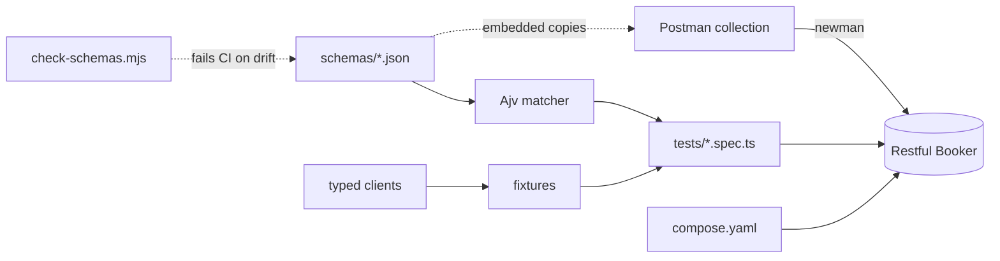
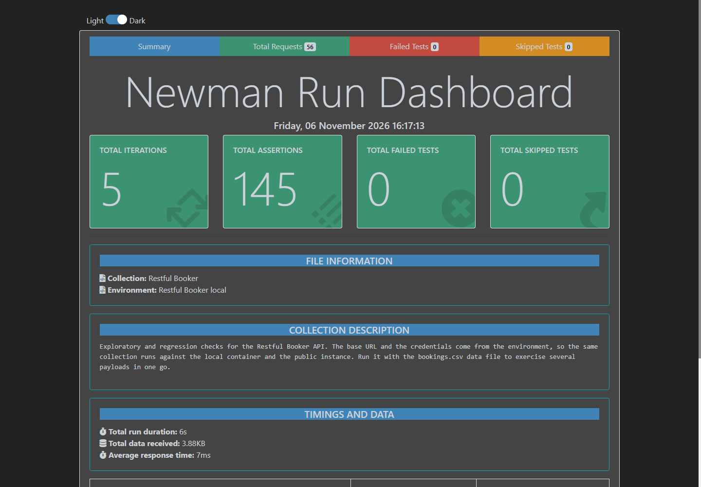
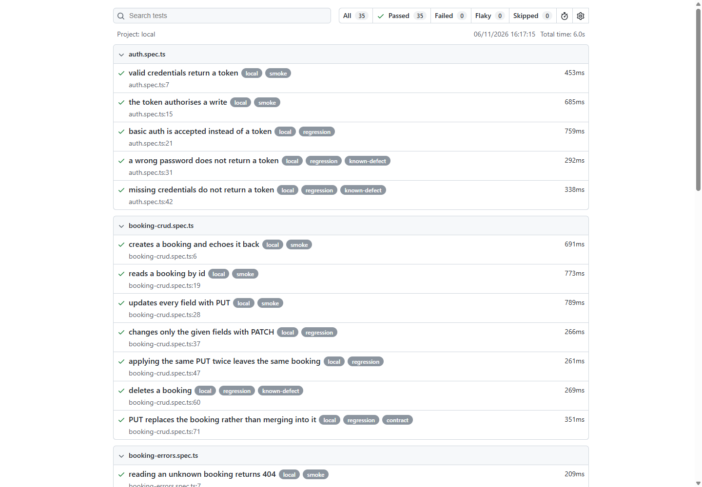

# API Testing Suite

API tests for Restful Booker, from an exploratory Postman collection run with Newman to typed Playwright tests, both enforcing the same JSON contract in CI.

[](https://github.com/jokvir/api-testing-suite/actions/workflows/ci.yml)
[](https://jokvir.github.io/api-testing-suite/)
[](LICENSE)

I picked [Restful Booker](https://restful-booker.herokuapp.com) because it is honest about being a practice API and, as a result, it misbehaves in interesting ways. A `DELETE` answers `201 Created`. Bad credentials answer `200`. A `PUT` quietly merges instead of replacing. That makes it a better subject than a perfectly behaved API: most of the work in API testing is deciding what to do when the implementation and the documentation disagree.

Before writing a single test I probed the live API and read its source. Everything asserted here is behaviour I observed, not behaviour I assumed.

## What this project demonstrates

- A Postman collection with folders per resource, a pre-request script that resolves the token once, environment-driven base URLs, and assertions on status, headers, response time and JSON Schema.
- A data-driven Newman run where an empty CSV cell means the field is left out of the payload entirely, not sent as an empty string.
- A typed client layer over Playwright's `APIRequestContext`, with an intent method and a raw method per call so negative tests can assert a status without the client throwing.
- Fixtures that hand each test its own booking and delete it afterwards, so the suite runs fully parallel against shared state.
- Contract testing with Ajv: the JSON Schemas live in the repo, use `additionalProperties: false`, and a renamed or added field fails the build.
- A CI step that fails when the collection's embedded schemas drift from the ones the code tests use.
- Defects separated into two kinds: odd status codes asserted as observed with an annotation naming the correct behaviour, and documentation bugs written against the documentation and marked `test.fail()` so a fix turns them red.
- A pinned local container as the CI target, so a third-party demo site can never turn a build red.

## Tech stack

| Tool                                                  | Version                   | Role                                             |
| ----------------------------------------------------- | ------------------------- | ------------------------------------------------ |
| Playwright Test                                       | 1.65.0                    | Runner, `APIRequestContext`, HTML report, traces |
| TypeScript                                            | 6.0.3                     | Strict mode, `noUncheckedIndexedAccess`          |
| Ajv + ajv-formats                                     | 8.20.0 / 3.0.1            | JSON Schema validation behind a custom matcher   |
| Newman                                                | 6.2.3                     | Runs the Postman collection outside the app      |
| newman-reporter-htmlextra                             | 1.23.1                    | Newman HTML report                               |
| ESLint + typescript-eslint + eslint-plugin-playwright | 10.14.0 / 8.72.1 / 2.12.0 | Type-aware linting                               |
| Prettier                                              | 3.9.10                    | Formatting                                       |
| Docker Compose                                        | any recent                | Runs Restful Booker locally and in CI            |
| GitHub Actions + GitHub Pages                         |                           | CI and report hosting                            |

No browsers are installed: API tests do not need them, so `npm ci` is all CI has to do before running.

## Architecture

```
.
├── .github/workflows/ci.yml      lint, Newman, Playwright, report, deploy
├── compose.yaml                  Restful Booker, image pinned by digest
├── docs/
│   ├── TEST_PLAN.md              scope, risks, traceability, defect register
│   ├── index.html                landing page for the published reports
│   └── images/                   report screenshots
├── postman/
│   ├── restful-booker.postman_collection.json
│   ├── env/                      local and public environments
│   └── data/bookings.csv         five rows driving the Newman run
├── schemas/                      the contract: booking, ids, created, token
├── scripts/check-schemas.mjs     fails CI when the collection drifts
├── src/
│   ├── clients/                  one typed client per resource
│   ├── data.ts                   booking builder with worker-unique names
│   ├── fixtures.ts               clients, token, booking lifecycle
│   ├── known-defect.ts           tags and annotations for expected oddities
│   ├── schema.ts                 Ajv wired into expect().toMatchSchema()
│   └── types.ts
├── tests/                        seven specs, 35 tests
└── playwright.config.ts          local and public projects
```



## Getting started

Prerequisites: Node.js 24 and Docker.

```bash
git clone https://github.com/jokvir/api-testing-suite.git
cd api-testing-suite
npm ci
npm run verify
```

`npm run verify` starts the container, waits for its health check, runs the Postman collection and then the code tests. On a cold start that is about thirty seconds.

| Command                               | What it does                                        |
| ------------------------------------- | --------------------------------------------------- |
| `npm run api:up` / `npm run api:down` | Start and stop the local API                        |
| `npm test`                            | Code tests against the local container              |
| `npm run test:smoke`                  | The ten `@smoke` tests                              |
| `npm run test:public`                 | Code tests against the public instance              |
| `npm run postman`                     | Newman run with the htmlextra report                |
| `npm run lint` / `npm run typecheck`  | ESLint, Prettier and `tsc`                          |
| `npm run schemas:check`               | Fails if the collection has drifted from `schemas/` |
| `npm run report`                      | Opens the last Playwright report                    |

There are no secrets to configure. Restful Booker publishes its demo credentials, and `.env.example` documents the variables you can override.

## Running in CI

[GitHub Actions](.github/workflows/ci.yml) runs `lint` first, then `newman` and `playwright` in parallel, then assembles and deploys the reports.

Both test jobs bring the API up with `docker compose up -d --wait` rather than a GitHub `services:` block. That keeps the image digest in one file instead of three, and it means CI runs the exact command I run locally. The `--wait` relies on the health check defined in `compose.yaml`, so there is no hand-rolled wait loop in the workflow.

Reports are published to GitHub Pages on every push to `main`:

- **[All reports](https://jokvir.github.io/api-testing-suite/)**
- [Newman](https://jokvir.github.io/api-testing-suite/newman/)
- [Playwright](https://jokvir.github.io/api-testing-suite/playwright/)

## Test strategy and design decisions

### When I reach for Postman, and when I reach for code

I use Postman while I am still learning an endpoint. Reading the docs, trying a payload, watching what comes back — that loop is faster in Postman than in a test file, and the requests are worth keeping afterwards. A collection is the artefact I can hand to a product owner, a support engineer or a backend developer, and they can run it without installing a toolchain. It is documentation that executes.

I use code once the behaviour is settled and has to stay settled. Types catch a renamed field before the test runs. Fixtures make setup and teardown reliable instead of depending on request order. A custom matcher keeps the assertions readable. This is the layer I am willing to block a merge on.

The two layers hit the same endpoints deliberately. They share the JSON Schemas so neither can drift from the other without the build saying so.

### How this maps to a team workflow

A story arrives with acceptance criteria. I explore the endpoint in Postman and save the requests that turned out to matter, which usually surfaces at least one criterion nobody had written down. The criteria that need to hold forever become code tests; the rest stay in the collection. Both go in the same pull request as the implementation, and the traceability table in [docs/TEST_PLAN.md](docs/TEST_PLAN.md) is what I attach to the ticket before moving it to review.

### The schemas are the contract

Every schema sets `additionalProperties: false`, so the suite fails on a field that appears as well as on one that disappears. Validating against a schema stored in the repository is the difference between a test and a contract check: the test says this response was fine today, the contract says this is the shape callers depend on.

A Postman collection has to be self-contained to be importable, so it embeds its own copies in collection variables. Rather than accept that they will drift, `scripts/check-schemas.mjs` compares them to `schemas/` and fails the lint job. Postman's `jsonSchema` matcher has no schema registry, so the single `$ref` in `created-booking.json` is resolved inline in the test script, with a comment saying why.

### Two kinds of defect

Status-code oddities are asserted exactly as the API behaves, tagged `@known-defect`, and carry an annotation naming the correct behaviour. The report shows what the API does and what it should do side by side, and the suite stays green so a real regression stands out.

Two cases are different: the implementation contradicts the published documentation. `UpdateBooking` is documented as a full update but merges with `Object.assign`; the `checkin` filter is documented as "greater than or equal to" but builds a `$gt` query. Those are written against the documentation and marked `test.fail()`. They count as passing today and turn red the day someone fixes the API, which is exactly when I want to hear about it.

The full register is in [docs/TEST_PLAN.md](docs/TEST_PLAN.md).

### Isolation without serialising the suite

The whole suite runs fully parallel against a single in-memory API. Each test gets a booking from a fixture that creates it beforehand and deletes it afterwards, and `newBooking()` stamps the worker's process id into the names, so two tests searching by name at the same time each find exactly one result.

### Two targets, as projects rather than environment variables

`local` and `public` are Playwright projects with their own `baseURL` and their own response-time budget. `npm test` and `npm run test:public` work the same on Windows and Linux, which `BASE_URL=... npm test` does not, and the budget becomes configuration instead of a condition inside a test.

### What the response-time assertions are and are not

They are a smoke alarm, not a benchmark: 500 ms against the local container, 5 s against the public one. They catch an endpoint that has become pathologically slow. Measuring throughput or latency under concurrency is load testing, which needs a target I own.

## Reports

Newman, five data rows in one run:



Playwright, with the tags visible on each test:



## Possible next steps

- Generate an OpenAPI description from the schemas and assert the collection and the code tests against it, so the contract has one source instead of two synchronised copies.
- Add a scheduled smoke run against the public instance, reported separately so its flakiness never gates a merge.
- Cover the XML and form-urlencoded representations the API also serves; the parser has a code path that answers `418` and nothing currently exercises it.
- Replace `test.fail()` with a check against a pinned image digest, so an image bump that changes behaviour is reported as a behaviour change rather than an unexpected pass.

## A note on `npm audit`

`npm audit` reports 11 advisories, all dev-only and all inside Newman's transitive dependency tree. I pinned patched versions of eight packages through `overrides` in `package.json` and re-ran both suites to confirm nothing broke, which cleared 20 of the original 31 including the only critical one. What is left needs major-version jumps Newman has not adopted: `csv-parse` 4 to 7, `uuid` 9 to 11, `@faker-js/faker` 5 to 10. Forcing those to silence a dev-only advisory is a worse trade than saying so here.

## Author

Shones Tegang — QA Automation Engineer.

- GitHub: [jokvir](https://github.com/jokvir)
- LinkedIn: [shones-tegang](https://linkedin.com/in/shones-tegang-5647741b5)
